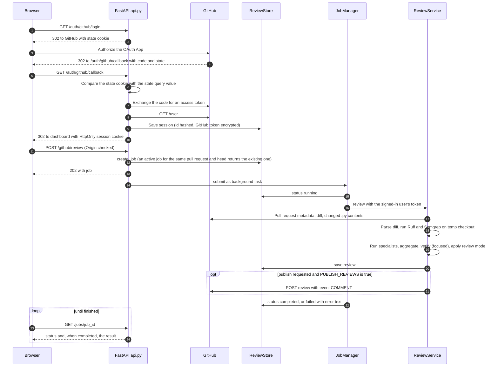
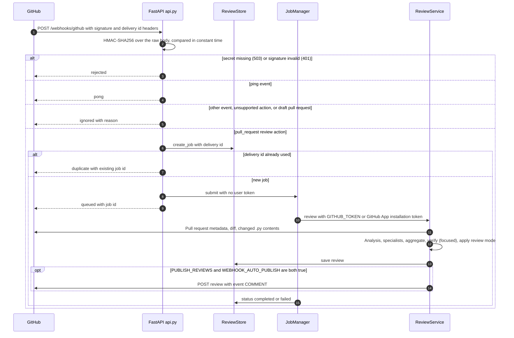
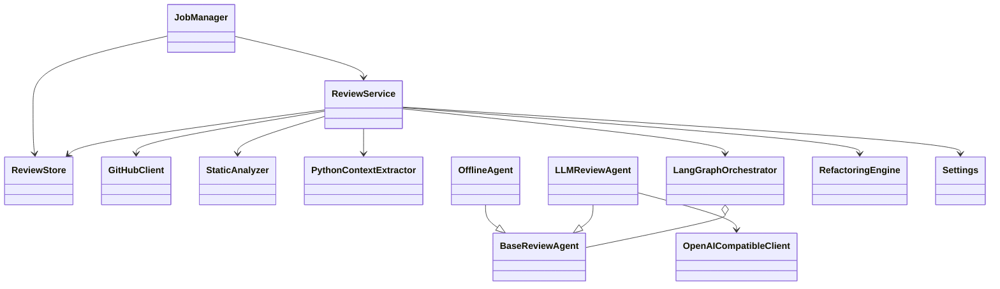

# Architecture and UML

PRISM is an advisory reviewer. A dashboard request, an API request or a signed GitHub webhook
identifies one pull request. The GitHub client fetches the metadata, the unified diff and the
contents of the changed `.py` files. Repository files are written as inert data into a
temporary directory. Ruff and Semgrep read only that directory. Python context extraction uses
`ast.parse` and never imports repository code. Four specialists then run concurrently on the
patches and the bounded context. Their findings are checked against the added-line map,
deduplicated and ranked, and in focused mode a verification pass can drop unsupported agent
findings. The result is stored in PostgreSQL or SQLite. Only then can it be posted as a `COMMENT`
review, and only when publishing is enabled.

## Components

```mermaid
flowchart LR
  BR["Browser dashboard"]
  CLI["pr-reviewer CLI"]
  GH["GitHub REST and OAuth"]
  subgraph API ["FastAPI app (api.py)"]
    OAUTH["OAuth and sessions (auth.py)"]
    ROUTES["Review, job and history routes"]
    HOOK["Webhook handler (HMAC check)"]
  end
  JOBS["JobManager (jobs.py) with bounded concurrency"]
  SVC["ReviewService (service.py)"]
  GHC["GitHubClient (github.py)"]
  PARSE["Diff parser and line map (parser.py)"]
  CTX["Python AST context (context.py)"]
  STATIC["Ruff and Semgrep (analyzers.py)"]
  ORCH["LangGraph fan-out (orchestrator.py)"]
  AGENTS["Four specialists (agents.py, llm.py)"]
  VER["Verifier, focused mode only (verifier.py)"]
  AGG["Deduplicate and rank (aggregator.py)"]
  MODE["Focused or full filter (review_mode.py)"]
  REF["Suggestion validator (refactor.py)"]
  STORE["ReviewStore (database.py)"]
  DB[("PostgreSQL or SQLite")]
  PIPE["review_diff (pipeline.py)"]

  BR -->|"sign-in and review requests"| ROUTES
  BR -->|"OAuth redirect"| OAUTH
  CLI -->|"diff file, offline or with repo"| PIPE
  OAUTH -->|"code exchange, user profile"| GH
  OAUTH -->|"encrypted session"| STORE
  ROUTES --> JOBS
  ROUTES -->|"POST /review, no repository"| PIPE
  HOOK -->|"queued job, deduplicated by delivery id"| JOBS
  JOBS --> SVC
  SVC --> GHC
  GHC <-->|"metadata, diff, contents, publish"| GH
  SVC --> PARSE
  SVC --> PIPE
  PIPE --> CTX
  PIPE --> STATIC
  PIPE --> ORCH
  PARSE --> ORCH
  ORCH --> AGENTS
  AGENTS --> AGG
  STATIC --> AGG
  AGG --> VER
  VER --> MODE
  MODE --> REF
  REF --> STORE
  STORE --> DB
  SVC -->|"publish if permitted"| GHC
```

Two paths reach the same pipeline. `review_diff` in `pipeline.py` takes a diff, an optional
checkout and a list of agents. The CLI and the synchronous `POST /review` call it directly.
`ReviewService` wraps it for pull requests: fetch, materialize, review, store and publish.

## Review job sequence (dashboard)

## Webhook sequence

A failed delivery releases its delivery id, so a redelivery starts a fresh job instead of
replaying the failure. Webhook reviews carry no requester, so they are visible to demo accounts
and to the unauthenticated local mode only.

## Main classes

`verify_findings` in `verifier.py` is a function, not a class. It takes the same
`OpenAICompatibleClient` used by the specialists.

## Fault tolerance and state

- Each specialist runs inside `run_agent`. A timeout (`AGENT_TIMEOUT`), an exception or a quota
  failure is recorded as an `AgentRun` with status `timed_out` or `failed`, and the other
  specialists still contribute. Failures appear as warnings on the result.
- If the verification call fails, its findings are kept and a warning is added. Verification can
  only remove findings.
- If LangGraph cannot be imported, the pipeline falls back to concurrent `asyncio` dispatch and
  records a warning.
- Job failures are written to the job record with the error text. At startup, jobs left active by
  a previous process are marked failed (`fail_interrupted_jobs`), so no job stays in progress forever.
- Persistence has three tables: `review_history` (review payload, repository, pull number, head
  commit and requester), `review_jobs` (status, trigger, publish flags, errors and delivery id) and
  `user_sessions` (hashed session id, login, encrypted token and expiry). `create_schema` adds the
  requester column to databases created before it existed.
- Focused and full review modes apply after aggregation. The verifier runs only in focused mode.

## Security boundaries

Repository content, diffs and comments are treated as data. Analysers are run with fixed argument
arrays and `shell=False`, and repository configuration files are excluded, so a pull request
cannot switch off the tools that review it. Credentials are read from the environment and never
returned to the browser. The full model, including the OAuth scope trade-off, is in
[SECURITY.md](SECURITY.md).
