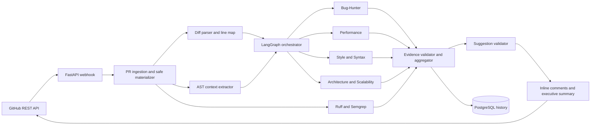
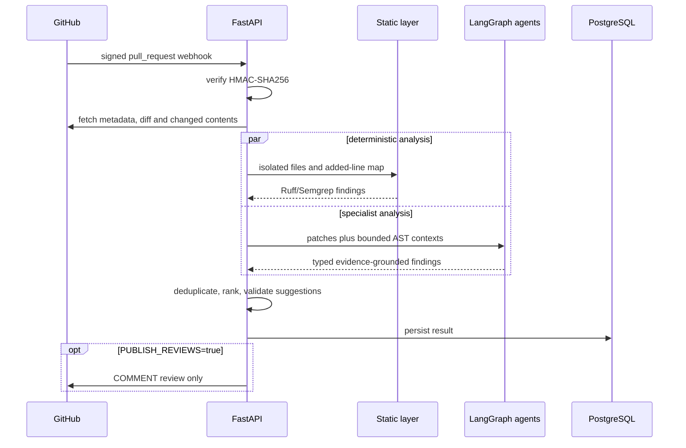
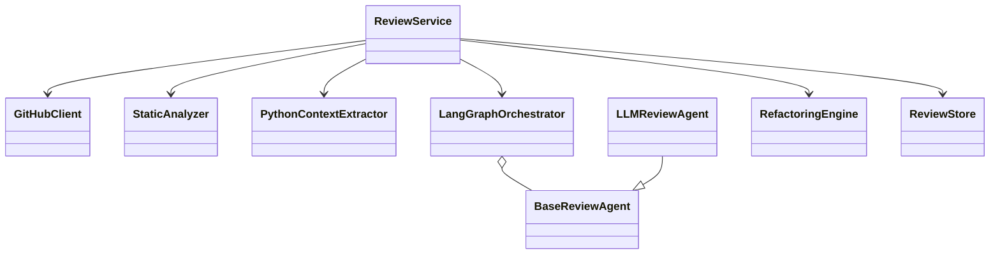

# Architecture and UML

The reviewer is advisory. A webhook or explicit API request identifies a pull request. The GitHub adapter fetches the diff and changed file contents as inert data into a temporary directory. Ruff and Semgrep inspect only that isolated materialization. Python context extraction uses `ast.parse`; it never imports repository modules. Four LangGraph nodes call independent structured-output specialists concurrently. The aggregator validates locations, consolidates overlap and ranks findings before the GitHub adapter posts a `COMMENT` review.

## Component diagram

## Review sequence

## Main classes

